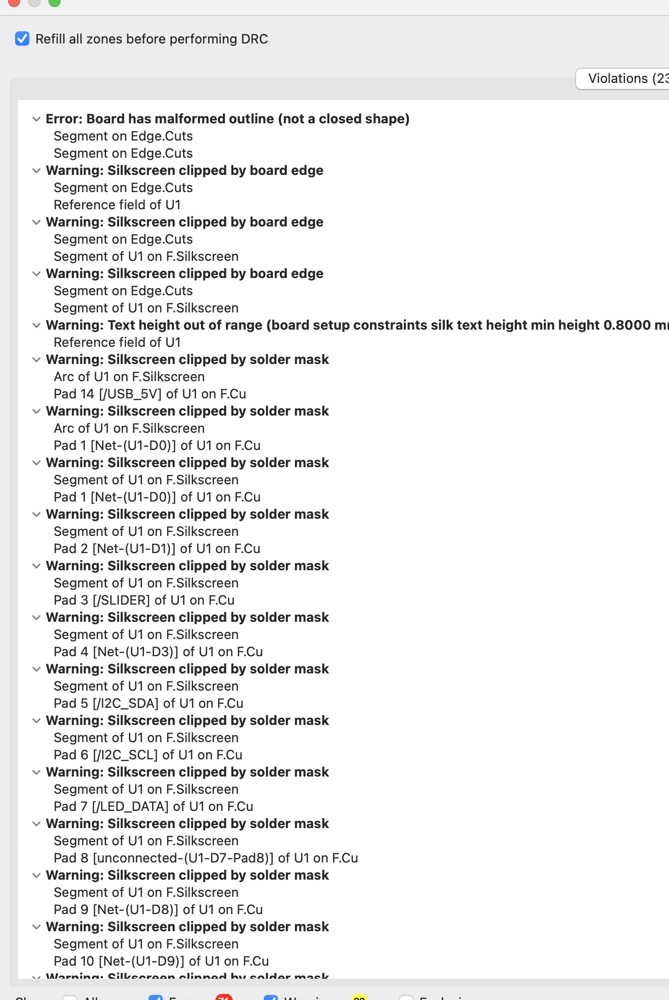
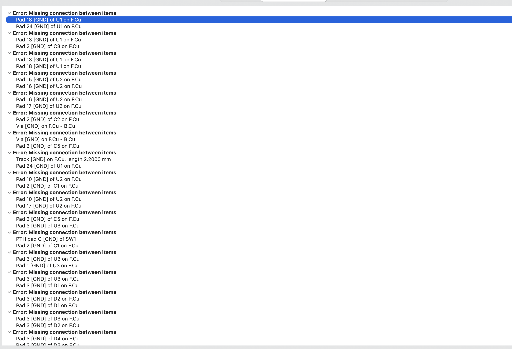
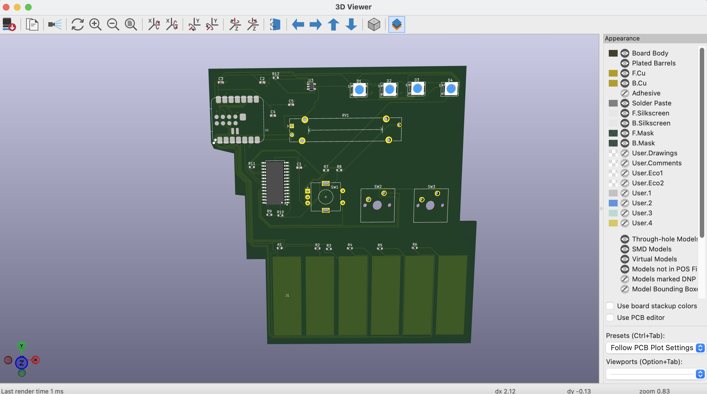

# SOUNDLED PROJECT!!
For my Hack Club Half Life project, I decided to create a device similar to the guide for week 3. However, I wante dot add more LEDS, and make it more fun. Plus I Added more resitors, and more power for the PCB desgin. ALso the shape is kind of uniquee, and looks different. 

I've been getting more interested in electronics, coding, and designing my own hardware. One thing I really like about these projects is that I can create something that relates to my reativity(basiclly designing, and creating my custom ideas.)

I also didn't want to make something that was too simple(even though this projec tmight be simiple for others). I wanted a project where I would actually have to figure things out, make mistakes, and learn how different components work together(since I'm new, the project was really hard). 

Materials: 

- **6 capacitive touch keys:** These are meant to act as the main  inputs. Instead of using regular mechanical switches for every key, I wanted to experiment with touch-sensitive copper pads.
- **1 rotary encoder:** This can be used to adjust settings, such as volume or another MIDI control.
- **1 slide potentiometer:** I added this so I could have a physical slider for controlling a continuous value.
- **2 mechanical buttons:** These provide extra inputs that I can assign different functions to.
- **4 RGB LEDs:** I wanted the keypad to have some visual feedback instead of just sending signals without showing anything.
- **XIAO ESP32-S3:** This is the main microcontroller that will read the inputs and control the outputs.
- **MCP23017 GPIO expander:** I included this to provide additional input/output

HERE are the steps: 

1. 

I started this project by thinking about what kind of PCB I actually wanted to make. I didn't want to just copy a basic circuit from a tutorial because I wanted to create something that I could eventually use. After thinking about different ideas, I decided to make a custom MIDI keypad. My plan was to design a controller with six touch-sensitive keys, four RGB LEDs, two mechanical buttons, a rotary encoder, and a slider(these were complicated to use for me).

2. 

Once I had the idea, I started figuring out which components I needed.

I chose the XIAO ESP32-S3 as the main microcontroller because it was small enough to fit on my PCB and had the features I needed.

Step 3: Creating the Schematic 

After choosing the components, I opened KiCad and started creating the schematic.

I placed the XIAO ESP32-S3 first because it was the main part of the circuit. Then I added the MCP23017, rotary encoder, slide potentiometer, RGB LEDs, buttons, resistors, and capacitors.

I connected the different components using wires and net labels. This helped me keep the schematic organized instead of having wires crossing everywhere.

Some of the main connections I made were:

- The six touch inputs to the ESP32-S3 through their resistors.
- The MCP23017 to the ESP32-S3 using I2C.
- The rotary encoder and mechanical buttons to the MCP23017.
- The slide potentiometer to an ESP32-S3 input.
- The RGB LEDs in a chain, with their data signal passing through the level shifter.
- The required power and ground connections.

Errors I went through: I felt soo tired after doing the systematic for 3 hours! I kept switching the componets I used, and I had no idea how to use them..........(took me a whole hour to figure out the connects lol(I kind of cursed,maybe..)) 
Here are a bunch of images of the process(pls don't judge me for taking to long(i did this with no help, so it took me soo long)):

 

One thing I learned during this part was how important net labels are. They made it much easier to understand which components needed to connect, especially once the circuit started getting complicated.(next time im making a schematic, I will defensity use net lables, they help me sooo much!)

4. Assinging the footprints(another hard step....)

After working on the schematic, I needed to assign footprints to the components. The footprint is basically the physical layout of the component on the PCB, including where the solder pads go. I assigned footprints for the resistors, capacitors, switches, LEDs, rotary encoder, and other components. (it was sooo hard, because I had to keep searching for the footprints, and rewriting them. ALso I forogt to save the footprints after assinging them. And after thre times of doing this mistake, I finally was able to save the footprints). 

One of the more difficult parts was the XIAO ESP32-S3 because I needed a specific footprint for it. I imported a custom 25-pad footprint into KiCad so I could place the microcontroller on the board.(This was extrmely hardddd. I had to search for the footprint file online, took me soo long(like 20-30 min))

This taught me that choosing the correct symbol isn't enough. The footprint also needs to match the actual physical component(next time I'm remeberign to assign footprints correctly unlinke how i did for this project). 

Images: 

5. Desiiging PCb(Attempt 1 of 3 btw, sorry it took soo long) 

Once the footprints were transferred successfully, I opened the PCB Editor.A ll the components appeared on the screen, and I started arranging them.I placed the six touch keys along the bottom because I wanted them to be easy to access. I was able to reragne them in the order I liked, here is an image of my order: 

At this point, I was mostly thinking about how the board looked.I wasn't thinking enough about how the traces would actually travel between components. This was a bad mistakke....

MISTAKE 1: Placing Components Before Planning the Routing

I arranged components based on their appearance and available space. However, once I started routing, I realized that many components needed to connect to parts on the opposite side of the PCB. IT TOOK ME TWO WHOLE HOURS JUST TO ATTEMPT IN ROUTING THE WIRES(sorry if it is caps. It jsut shows how much stressed I was, and how I kept failing...)

MISKTAKE 2: Routing Without a Clear Order

I initially started connecting different pads whenever I saw a convenient connection. This was a badd mistkae. It cost me aroudn 1.5 hours...
 Problem: This made the board messy, and i didnt understnad anything lol. 

I didn't have a clear plan for which signals should be routed first.fter a while, some of the important connections were blocked by traces I had already drawn.I tried working around them, but that made the layout even more complicated.

MISTAKE 3:(yep theres three mistkaes for frist attmept) Not Leaving Enough Room

I also didn't leave enough room around certain components for traces and vias.his became a problem when I needed to connect power and ground. By then, I had already routed several signals through the available space. Took me like five hours to realise I needed to redesign btw. 

6. Redesigning My PCB (second attmpet) e(finally the good part(took me 2 hr))

After struggling with the first layout, I decided to redo it instead of continuing to make the routing messier.I went back and adjusted the component arrangement.I tried to make the board easier to route by grouping components according to their connections. This was superrr helpfill. 

I also wanted the LEDs to be arranged so their data connections could follow a logical path. The six touch keys stayed along the bottom because that was an important part of my original design.

HERE ARE MY CHANGES: 
During this redesign, I focused on: 

1. Making the component layout more organized.

2. eeping related components closer together.

3. Leaving more space for traces.

4. Making the touch keys easier to access.

5. Improving the arrangement of the RGB LEDs.

6. Keeping the XIAO's USB connector accessible.

This version was better organized than the first attempt, but I still ran into routing problems. I had improved the layout, but I hadn't completely solved the problem of how to route so many connections on a crowded board. SO I reattmepted a third time lol

IMages of 5 step and step 6: 

7. My Second Major Routing Attempt

I started routing the redesigned PCB.At first, it seemed like things were going better, but ig not. I connected the wires, and tried my bes tot be neat. However, the conencitons were too much so I decided, bwhy not use a easier way? I asked google obsiously, since Im new to explain how to simply the process of routing. 

Google told me to use the two layers Bu Fu,a nd create a cooper layer for GND pins, this way I didnt need to connet them. Also some of the other pins where difficult to connect. To do these things I followed the steps bellow:

1. vias: A via is a plated hole that connects copper between layers.

For example, I can start routing on F.Cu, place a via, continue on B.Cu, and then use another via to return to F.Cu.

THIS was SOOOO usefullll. I am soooo happy I was able to learn Via's and connecting the wires with GND layers 

Also another thing I did: 

Edit → Global Deletions

This allowed me to remove the existing tracks and vias without deleting all the components. It was frustrating to lose the routing work tbh, but I think restarting was the right decision.

9. Routing the Six Touch Keys

I started with the six touch keys because they were one of the main features of the project.Each touch pad had its own signal connection through a 510-ohm resistor.The resistors were R1 through R6.

It was the simplest part tbh. 

10. Routing the Mechanical Buttons

I added two mechanical buttons, SW2 and SW3. These were Cherry MX-style switches.

I connected their signal nets, BTN_1 and BTN_2, to the MCP23017.I left the ground connections for later because I planned to use a copper ground zone.

11. Routing the Slide Potentiometer

Next, I worked on RV1, the slide potentiometer. The slider has three electrical connections:

1. One end of the resistive element.

2. The moving wiper.

3. The other end of the resistive element.

I had initially forgotten that the slider still needed its power connection(silly mistake).

I caught that mistake while working through the remaining connections.

13. Routing the Four RGB LEDs

The RGB LEDs were another part that required careful routing.

I connected them in a chain:

D1 to D2 to D3 to D4 

Each LED's data output connects to the next LED's data input. I also connected the first LED to the level shifter through R12.The data traces were manageable, but the power connections became difficult because of the existing routing cause I needed 5v power, and GND

14. Connecting the 3.3V Network(the hard part starts!)

After finishing many of the signals, I started connecting the 3.3V power network.This was one of the parts that confused me the most. At first, I thought every resistor and component needed its own separate trace all the way back to the ESP32-S3. I used this method to connect the pull-up resistors.My connections included R7, R8, R9, R10, and R11. I also connected the MCP23017's 3.3V supply and the slider's 3.3V connection.
IT WORKED! I was able to finishs 3.3v power!

15. Connecting the 5V Network

Next, I worked on the 5V power connections. The 5V network was used for the RGB LEDs and level shifter. I connected the ESP32-S3's USB_5V net to the appropriate capacitor and other 5V components.This part became difficult because several traces were already occupying the available space.I had to look for different routing paths and check which nearby pads were connected to the correct net.(really hard tbh)

16. Creating the Ground Copper Zone

Easy part, if i didnt make msitakes: 

I had connected many signals and power traces, but there were still a lot of missing GND connections.Instead of routing separate ground traces across the entire board, I created a copper zone.
How I Made the Ground Zone: In KiCad PCB Editor, I Selected the B.Cu layer. Chose the Add Filled Zone tool. Drew the zone around the board area. Assigned the zone to the GND net. Pressed B to refill the copper.

The shortcut B became especially useful because it helped with the filled copper zones.

When I pressed V, a small circle appeared near my cursor. and this allowed me to easily conenct the pins 

HERE ARE ALL THE IMAGES FOR THIS: 

17. My Biggest DRC Problem: 36 Errors(LOL, to much debugging(1hr))

Once I had routed most of the board, I opened KiCad's Design Rules Checker, I did: 

Inspect - Design Rules Checker - Run DRC

At one point, the checker reported: 36 errors and 23 warnings.

I was pretty frustrated because I thought I had already connected most of the components. In fact, I mighti've cursed again(mb). 

At first, I couldn't even figure out where the errors were being displayed.I was looking at the Violations tab, but many of the problems were listed under Unconnected Items. 

These are the most common erros/wanrings: 
1. Missing 3.3V connections.

2. Missing USB_5V connections.

3. Unconnected GND pads.

4. Missing rotary encoder signals.

5. Missing I2C connections.

6. Capacitors that weren't completely connected.

To solve this, I used vias to easily connect the wires. Took me soooo long. 

After fixing more ground connections, I got it down to just seven errors.

Seeing the error count decrease was one of the most satisfying parts of the project.

19. Fixing the Remaining Warnings

Even after getting zero errors, I still had warnings. At one point, the DRC showed 26 warnings.Three of them involved tracks with unconnected ends.

The warnings included:

"I2C_SCL — a 7.7400 mm track."

These were different from the earlier missing-connection errors.T hey indicated that some copper track segments had loose ends.

How I Fixed Them:

I rewired the connections that were wrongly wired. Next I ran DRC checker and got xero erros, and zero warnings. 

Images: 

Finally I viewed through 3d vierwer, and downlaod my .gerbes file: 

ONE thing to note: I dont need funding, so I will jsut put parts. 

Second: I didn't relaly know how to uplod the gerbes file, i treid my best though. I don't how to open it on github though. 